<div align="center">
  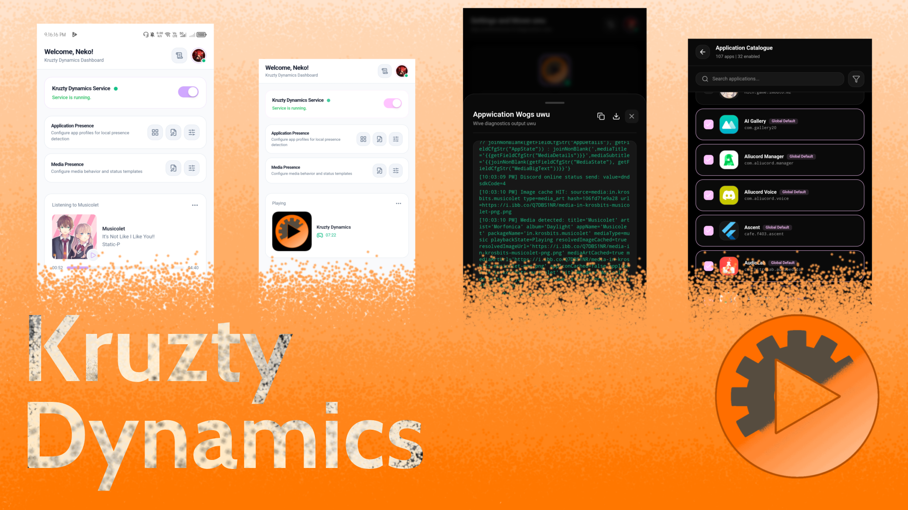

  <h1>Kruzty Dynamics</h1>

  <p>
    A Discord Rich Presence manager for Android — rebuilt from the ground up.<br/>
    Powered by a <strong>Rust core (Tauri v2)</strong>, a <strong>React 19 + TailwindCSS v4</strong> frontend,<br/>
    and a <strong>native Android bridge</strong> for real app &amp; media detection.
  </p>

  <p>
    
    
    
    
    
    
  </p>
</div>

---

## Screenshots

<div align="center">
  <table>
    <tr>
      <td>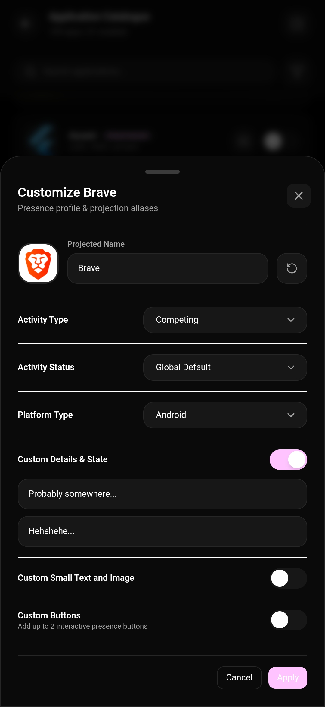</td>
      <td>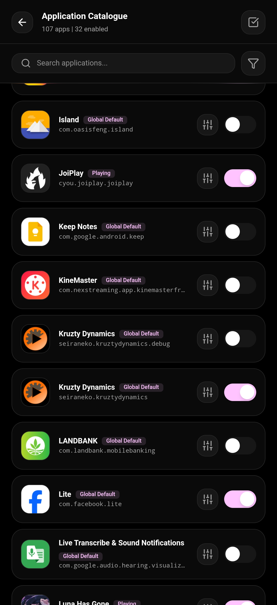</td>
      <td>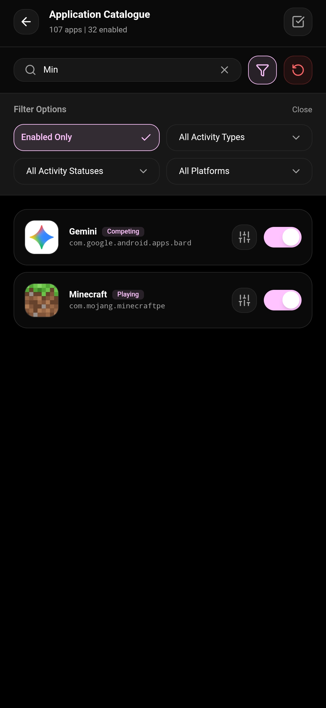</td>
      <td>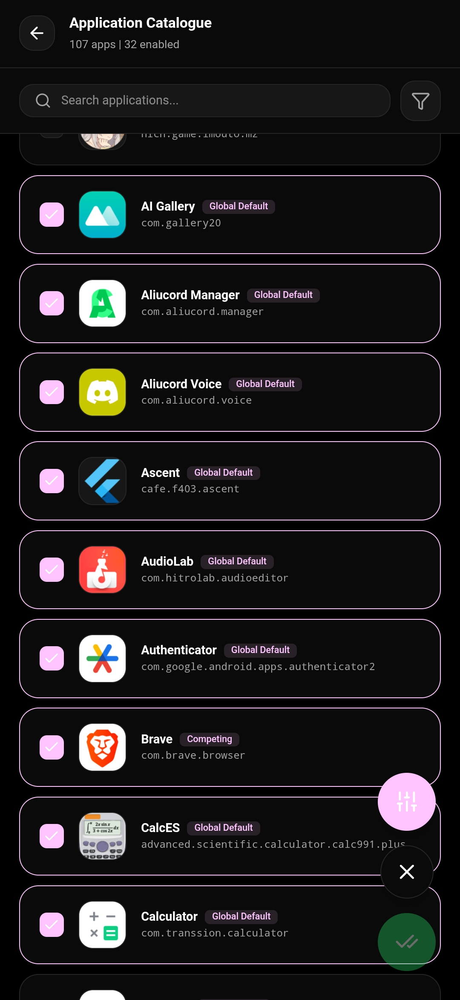</td>
      <td>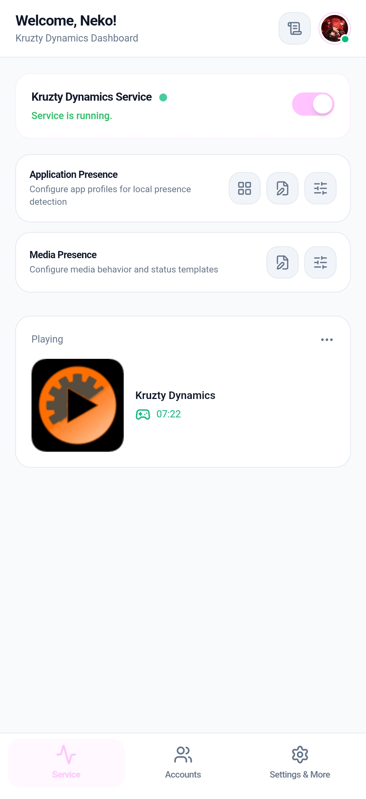</td>
    </tr>
    <tr>
      <td>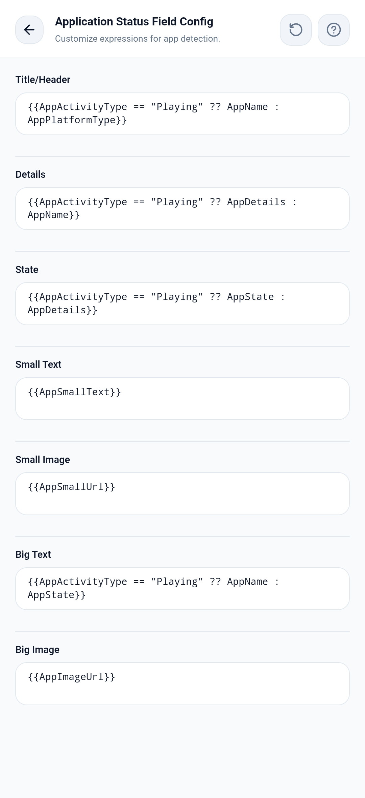</td>
      <td>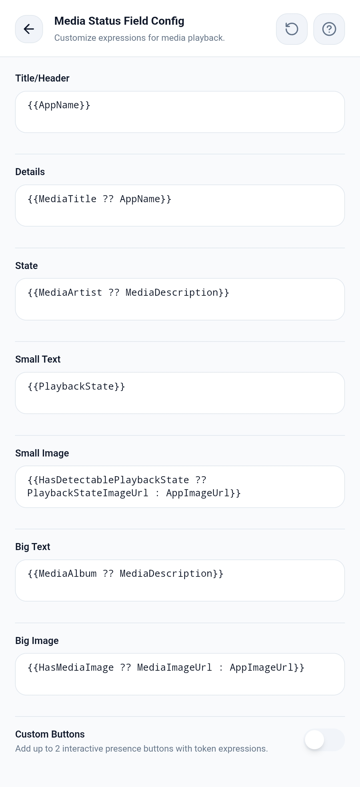</td>
      <td>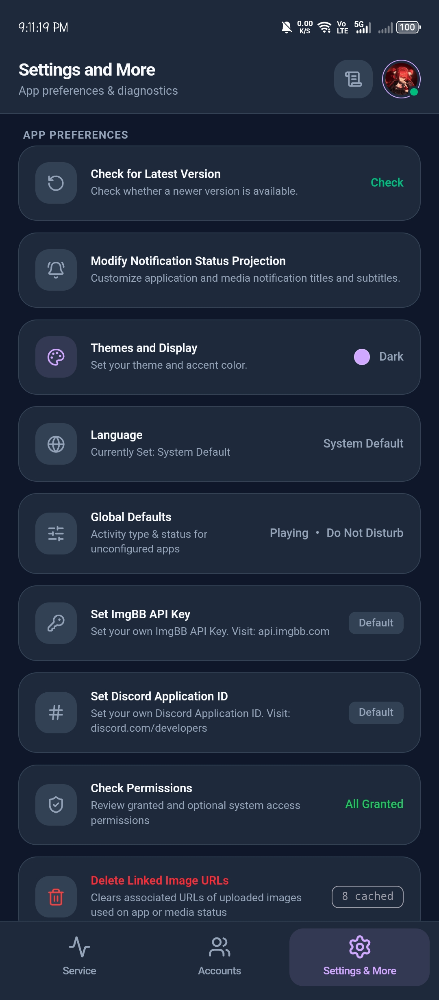</td>
      <td>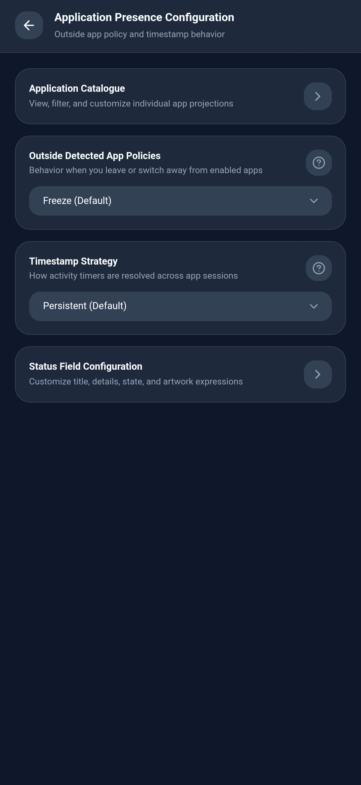</td>
      <td>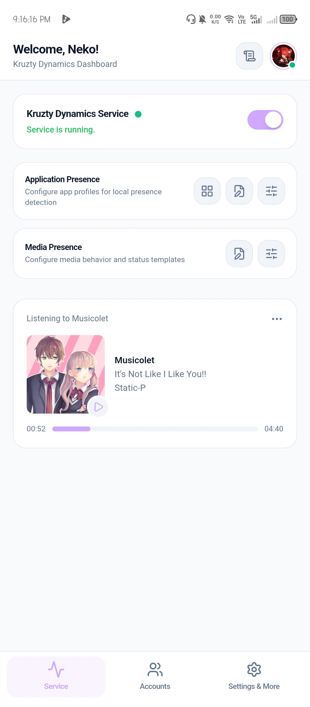</td>
    </tr>
    <tr>
      <td>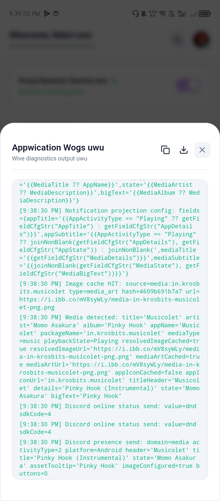</td>
      <td>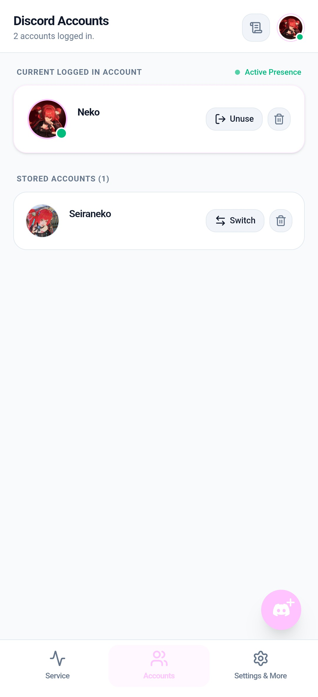</td>
      <td></td>
      <td></td>
      <td></td>
    </tr>
  </table>
</div>

---

## ⚠️ Read Before Downloading

> [!IMPORTANT]
> **Please read the [Privacy Policy](PRIVACY.md) before using this app.**
> Kruzty Dynamics uses Discord OAuth to link your account and publishes Rich Presence via Discord's Social SDK. The app detects your foreground app and media playback locally on-device using Android Usage Access and Notification Access permissions.

> [!WARNING]
> This app connects to the **Discord Gateway / Social SDK** to publish Rich Presence. Use at your own discretion. Custom rich presence has been a widely-used feature in the Discord ecosystem for years with no known cases of account termination, but this remains an unofficial use-case not sanctioned by Discord.

> [!CAUTION]
> Only download from **this repository's official releases**. Do not use third-party redistributions of this app — the maintainers cannot be held responsible for issues arising from unofficial builds.

<div align="center">
  <a href="https://github.com/LlanderSei/Kruzty-Dynamics/releases/latest">
    
  </a>
</div>

---

## Features

### 🎮 App Presence (Application RPC)
- **Live foreground app detection** — automatically detects the app you're currently using via Android Usage Stats
- **Application Catalogue** — browse, enable/disable, and individually customize any installed app's presence profile
- **Per-app overrides**: projected name, activity type (Playing / Streaming / Listening / Watching / Competing), platform type (Android, PC, PlayStation, Xbox, Nintendo Switch), activity status, and custom buttons with expression support (e.g., `{{AppName}}`)
- **Outside-app policies** — choose what happens when you leave a detected app: Freeze, Custom Fallback, or Drop (clear presence)
- **Batch operations** — select multiple apps at once to configure activity type, status, and enabled state in bulk

### 🎵 Media Presence (Media RPC)
- **Live media detection** — reads active media sessions via Notification Listener Service for title, artist, album, artwork, playback state, position, and duration
- **Priority modes** — Media First, App First, or App Only
- **Media scope** — All sources or whitelisted sources only
- **Activity type resolution** — Auto-Adaptive, Always Listening, or Always Watching
- **Time remaining** — shows real start/end timestamps or falls back to the app timestamp
- **Paused media resolution** — Show Paused State, Fallback to Detected App, or Hide Paused State
- **Configurable presence fields**: Big/Small image, activity details, state, and custom buttons with expression variables (`{{MediaTitle}}`, `{{MediaArtist}}`, `{{MediaAlbum}}`, etc.)
- Automatic icon resolution using Discord app art assets (`MediaPlay`, `MediaPause`, `KruztyDynamicsLogo`)

### 🖼️ Image Handling
- Automatic app icon and media artwork upload to **ImgBB** for Discord Rich Presence display
- Local image URL cache to avoid redundant uploads
- Custom Discord Application ID support for your own Rich Presence app
- Custom ImgBB API key support

### 🔗 Accounts
- **Discord OAuth / Social SDK login** — full PKCE authorization flow with encrypted token storage (AES-GCM + Android Keystore)
- **In-app Discord login portal** — opens a WebView portal for seamless sign-in without leaving the app
- **Multiple account support** — add, switch between, and remove Discord accounts

### ⚙️ Settings & Personalization
- **Themes**: Light, Dark, and AMOLED modes
- **Accent colors**: 8 preset colors + custom hex color picker
- **Localization**: 25+ language translations including English, Filipino/Tagalog, Japanese, Spanish, German, French, Chinese (Simplified), and more
- **Global Defaults**: configure a default Activity Type and Activity Status applied across all app profiles
- **Permissions management** — in-app permission status review with direct deep-link to relevant Android settings
- **Image cache management** — view and clear cached image URLs

### 🛠️ Service & Reliability
- Runs as an **Android Foreground Service** — continues detecting and publishing presence even with the screen off
- **Service shortcuts** — start/stop presence directly from the Android home screen
- **Battery optimization bypass** — optional exemption for uninterrupted background operation
- Customizable foreground notification template (what shows in your Android notification shade while the service is running)
- **Update checker** — checks GitHub releases at launch and from Settings
- Permission guards that prevent the service from starting without required permissions

### 📋 Onboarding
- Guided first-run flow with permission setup, theme/language selection, and account linking
- All onboarding state persists and mirrors Settings

---

## System Requirements

| | |
|---|---|
| **Android** | 8.1 (API 27) or later |
| **RAM** | 3 GB minimum recommended |
| **Permissions** | Usage Access, Notification Listener, Battery Optimization Exemption, Post Notifications |

---

## Building Locally

### Prerequisites

- **Android Studio** (Flamingo or later recommended)
- **Rust** toolchain (`rustup`) with `aarch64-linux-android` target
- **Node.js** 20+ and `npm`
- **Tauri v2 CLI** (`@tauri-apps/cli`)
- Android NDK and SDK configured in Android Studio

### Steps

```bash
# 1. Clone the repository
git clone https://github.com/LlanderSei/Kruzty-Dynamics.git
cd Kruzty-Dynamics

# 2. Install frontend dependencies
npm install

# 3. Add Android Rust targets
rustup target add aarch64-linux-android armv7-linux-androideabi i686-linux-android x86_64-linux-android

# 4. Initialize Tauri Android project (first time only)
npx tauri android init

# 5. Build the frontend
npm run build

# 6a. Build debug APK
npx tauri android build --debug --target aarch64

# 6b. Install to connected device
adb install -r src-tauri/gen/android/app/build/outputs/apk/universal/debug/app-universal-debug.apk
```

> [!TIP]
> For hot-reload development with a connected device over USB debugging:
> ```bash
> npx tauri android dev
> ```
> This runs the Vite dev server and streams JS changes without rebuilding the APK.

> [!NOTE]
> The Discord Social SDK native library (`cpp/discord_social_bridge.cpp`) requires Android NDK to be properly configured. Refer to the [Tauri Android guide](https://tauri.app/v2/guides/building/android/) for NDK setup.

---

## Credits

### Built on the shoulders of

- **[Kizzy](https://github.com/dead8309/Kizzy)** by [@dead8309](https://github.com/dead8309) — the original Discord Rich Presence manager for Android that this project is forked from and rebuilt upon. Kizzy pioneered app detection, media RPC, and the experimental presence features that form the foundation of Kruzty Dynamics. Licensed under GPL-3.0.

### Core Framework & Runtime

| Library | Role |
|---|---|
| [Tauri v2](https://tauri.app) | Cross-platform app framework (Rust backend + WebView frontend) |
| [React 19](https://react.dev) | UI framework |
| [TailwindCSS v4](https://tailwindcss.com) | Utility-first CSS framework |
| [Vite](https://vitejs.dev) | Build tool and dev server |

### Rust Dependencies

| Crate | Role |
|---|---|
| `tauri` v2 | Core Tauri runtime and plugin API |
| `tauri-plugin-log` | Log bridging from Rust to frontend |
| `reqwest` v0.12 | HTTP client (rustls-tls, json) |
| `serde` / `serde_json` | Serialization |
| `futures-util` | Async utility |

### Frontend Dependencies

| Package | Role |
|---|---|
| `lucide-react` | Icon set |
| `@tauri-apps/api` | Tauri JS/TS API bridge |
| `@tauri-apps/plugin-log` | Frontend logging |
| `typescript` | Type safety |

### Android / Kotlin

| Library / API | Role |
|---|---|
| **Discord Social SDK** | Rich Presence publishing |
| Android `UsageStatsManager` | Foreground app detection |
| Android `MediaSessionManager` + Notification Listener | Media playback detection |
| Android Keystore + AES-GCM | Encrypted token storage |
| Android WebView | In-app Discord OAuth portal |
| Android Foreground Service | Background presence publishing |

### Prior Art & Inspiration

- **[Kizzy](https://github.com/dead8309/Kizzy)** — original Kotlin + Jetpack Compose implementation of Android Discord RPC
- **[Rich-Presence-U](https://github.com/ninstar/Rich-Presence-U)** — Nintendo game data reference
- **[Xbox-Rich-Presence-Discord](https://github.com/MrCoolAndroid/Xbox-Rich-Presence-Discord)** — Xbox game data reference

---

## License

**Kruzty Dynamics** is open source under the **GNU General Public License v3.0 only (GPL-3.0-only)**.

It is derived from **Kizzy**, which is also licensed under GPL-3.0.

You are free to use, modify, and distribute this software subject to GPL-3.0 terms. When distributing a covered work, you must provide corresponding source code and preserve the rights the GPL grants to recipients.

See [LICENSE](LICENSE) for the full license text.  
See [PRIVACY.md](PRIVACY.md) for the Privacy Policy.  
See [TERMS_OF_SERVICE.md](TERMS_OF_SERVICE.md) for Terms of Service.
